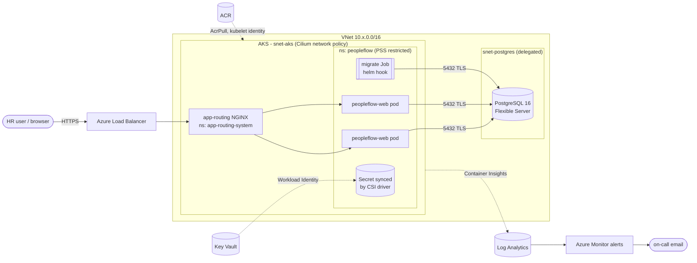
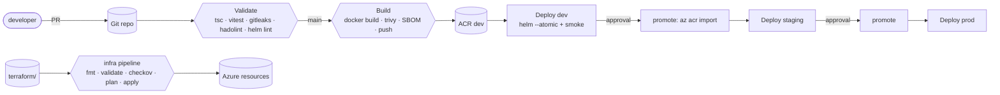

# PeopleFlow HR – Architecture

PeopleFlow HR is a multi-tenant HR platform: employees, attendance, leave, payroll, recruitment (ATS), performance and onboarding. It is built with Next.js 15 (UI and API routes in one process), Prisma 5 and PostgreSQL 16.

## The three tiers

| Tier | Local (Compose) | Local (kind) | Azure (AKS) |
|---|---|---|---|
| **1 – Web / edge** | `proxy`: NGINX 1.27 on :8080 | ingress-nginx controller | AKS app-routing add-on (managed NGINX) and a public Load Balancer |
| **2 – Application** | `app`: Next.js standalone server on :3000 | Deployment `peopleflow-web`, HPA 1–6 | Helm release `peopleflow`, HPA 2–10, PDB, Workload Identity |
| **2b – Migrations** | `migrate`: one-shot `prisma migrate deploy` | Job `peopleflow-migrate` | Helm hook Job (`post-install`, `pre-upgrade`) |
| **3 – Data** | `db`: postgres:16-alpine on an internal network | StatefulSet with a 2Gi PVC | Azure Database for PostgreSQL Flexible Server, private subnet only |
| **Secrets** | `.env.compose` (git-ignored) | Kustomize `secretGenerator` (lab values) | Key Vault → Secrets Store CSI → K8s Secret |
| **Observability** | `docker logs`, healthcheck | `kubectl logs/top` | Container Insights, Log Analytics, Azure Monitor alerts |

## Azure runtime view

## Delivery view

## Key decisions (ADR summary)

1. **Single app container.** Next.js serves both the UI and the API, so tier 2 is one image. The NGINX in front is the web tier: it terminates traffic, adds security headers and could cache static assets.
2. **Migrations are a separate image and Job**, never part of app startup. Several replicas starting at once must not race on `prisma migrate`.
3. **Build once, promote.** The image that passed dev is copied with `az acr import` to staging and then prod. It is never rebuilt.
4. **No long-lived credentials.** Pipelines use workload identity federation (OIDC). Pods use Workload Identity to reach Key Vault. Kubelets use a managed identity to pull from ACR. ACR has no admin user.
5. **Private database.** Postgres has no public endpoint. Only the AKS subnet may reach port 5432 (NSG), and only the web and migration pods may reach it inside the cluster (NetworkPolicy).
6. **Redis is not deployed.** The app has a Redis setting, but no code path uses it today. Add it as a tier-3 service when caching or queues are introduced.

## Health endpoints

| Path | Meaning | Used by |
|---|---|---|
| `/api/health` | Process is up (no DB call) | startup and liveness probes, Docker HEALTHCHECK |
| `/api/health/readiness` | Process is up **and** the DB answers | readiness probe, smoke tests, Compose healthcheck |
| `/nginx-health` | NGINX itself is up | Compose / load balancer checks |
